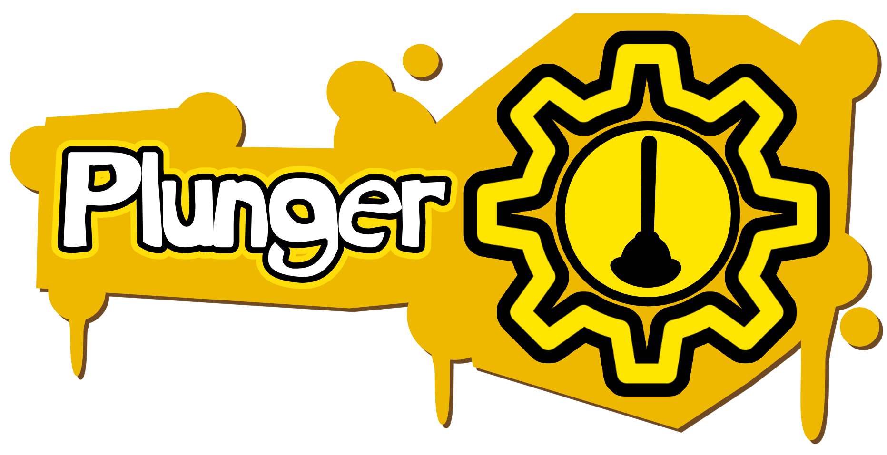
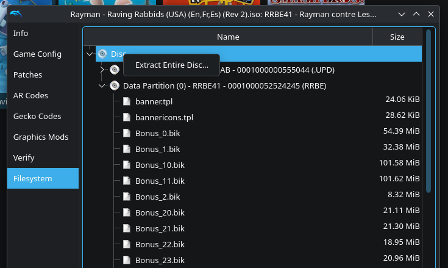
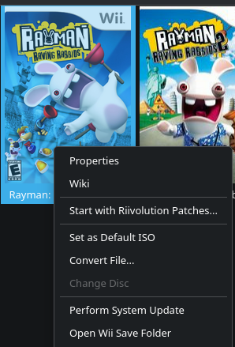

Plunger is a tool that allows you to create a mod on Rayman Raving Rabbids (Wii) and soon all other Rabbids games officially available on Wii. (This Project is not associated with Ubisoft or Nintendo)
# Installation Guide
Requirements:
- [Dolphin](https://dolphin-emu.org/?nocr=true) or equivalent
- [Rayman Raving Rabbids](https://en.wikipedia.org/wiki/Rayman_Raving_Rabbids) Wii ISO (Obtained legally, no ISO will be given)
- [RAD Video Tools](https://www.radgametools.com/bnkdown.htm) for video convert in .bik file

# Tutorial:
## Windows
- [Downlaod Latest Version](https://github.com/DYCAMAX/Rabbids-Mod-Framework/releases)
- Just Launch the .exe lol.

## Linux
- [Downlaod Latest Version](https://github.com/DYCAMAX/Rabbids-Mod-Framework/releases)
- Debian/Ubuntu:
  ```sh
  sudo apt update
  sudo apt install .deb
  ```
- Fedora:
  ```sh
  sudo dnf upgrade
  sudo dnf install .rpm
  ```
## macOS
Maybe one day I release this in macos.
## Extract Disc
- In Dolphin emulator, extract entire disc of the game (RRR1).
  
- in Plunger, you can open rayman 4.bf where almost totally of the game is stocked (Textures, Models etc....) or .bik files
- And now you can mod Rayman Raving Rabbids (Wii) !!!!
## Compile and Launch
- In Plunger, press file and compile
- put the name of your mod
- Press compile, and whan it is finish, your mod compatible riivolution appear in directory ./mods
## Dolphin Emulator
- In dolphin emulator, press click right on your game and select "Start with Riivolution Patches....."
  
- select your riivolution XML of your mod and start the game.
## Real Hardware (Wii/vWii)
(Before Started) You need a Wii 4.3 Hacked, Homebrew Launcher and the wad riivolution
- Launch Riivolution WAD (in Homebrew Launcher or channel with your Rayman Raving Rabbids 1 Disc in your console
- Press LAUNCH !!!
# Credits
Created By DYCAMAX 
- Thanks [Dolphin Team and the community](https://github.com/dolphin-emu/dolphin)
- Thanks [Riivolution](https://www.wiibrew.org/wiki/Riivolution)
- Thanks [Ubisoft Montpellier](https://www.ubisoft.com/en-us/studio/montpellier) for creating this game, Rayman and Rabbids 

